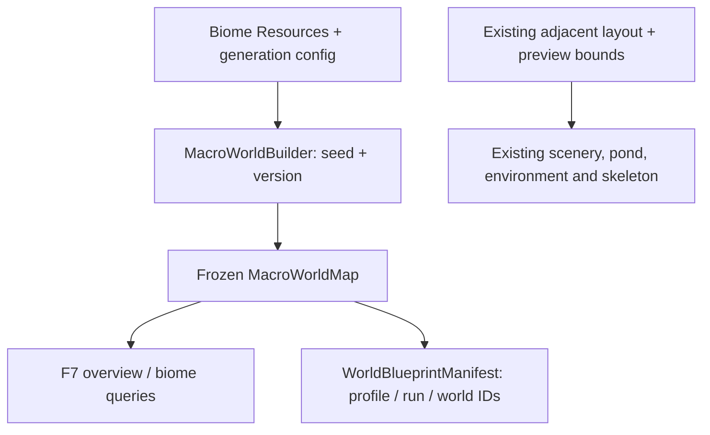

# P0/P1 historical audit and baseline — 22 October 2026

**Historical P0/P1 snapshot, not current production state.** P3 streaming and P4 durable campaign saves have since been implemented. Read [current generation](README.md), [phase plan](../../Generation_Implementation.md) and [SAVE](../../../SAVE/README.md). Baseline findings and measured evidence below are preserved.

## Actual ownership and data flow

The production preview has canonical Oak Forest/Pink Meadow definitions, shared generic tree scenes, rocks/grass, pond/wading, environment, fire, player and one skeleton. SAVE/Profiles and SAVE/WorldState remain scaffolding. DEBUG/TopDownTest is preserved.

The two branches deliberately coexist for P1. The generated macro map does not pretend to control the current ground shader or current scenery. P3 will replace the runtime branch with local chunks sampling the map.

## Identity contract

ProfileId owns player-facing metadata; RunId identifies a playthrough/slot; WorldId identifies its mutable world. Default future policy: one profile, one active run, one private world. Identical seeds reconstruct equal geography but never imply shared mutable state. Permadeath retention/deletion and multiple slots remain unresolved; no deletion logic is added.

P1 creates a fresh **disposable preview** profile/run/world triple, not a real selected player profile. `WorldBlueprintManifest.Create` accepts real profile/run GUIDs for future SAVE integration. The value-only serializable contract copies seed/version/bounds, biome IDs and complete coarse region ownership; no Resource references, node instance IDs or filesystem paths. JSON round-trip is tested, but there is no file writer, Continue flow, chunk delta save or persistent player profile yet. Array data in the DTO is a detached snapshot; it cannot mutate MacroWorldMap.

The future SAVE coordinator owns profile selection, schema migrations and atomic durable writes. WORLD owns geography/deltas. P3 chunk caches must include WorldId + layer + chunk coordinates. P4 must prove same-seed A/B profile isolation for edits, positions and clocks. Never use seed as save identity or reroll on Continue. Source generation/content settings for future local detail still need versioned snapshot support when P3/P4 introduce that detail.

## Required migration points for P2/P3

| Current assumption | Required change |
| --- | --- |
| AdjacentBiomeLayout + AdjacentBiomeBlend knows a fixed west/east pair | Sample macro geography and blend arbitrary neighbouring biome surfaces; preserve ground detail/snow and border continuity. |
| WorldSceneryPlacement walks population counts once with one advancing RNG | Density/area-based chunk data, separate keyed content streams, stable instance IDs, spatial indexing and cross-border ownership/halo sampling. |
| WorldScene configures one small ground/camera and generates everything at startup | Bounded active/preload/unload rings, hysteresis, generation/application budgets, valid player arrival and finite edge handling. |
| EnvironmentRuntime initializes after all actors exist | Load/unload registration and cleanup for wind, shadows, snow, atmosphere, rain splash and fire references; local biome environment transitions. |
| StaticObstacleNavigation builds an AStarGrid2D over all world bounds | Local navigation around active obstacles, safe updates and cleanup across chunk edges. Never scale the whole-map grid to macro bounds. |
| Pond is one authored region, excluded during startup scatter | Stable water feature/region ownership and shared reservation queries; preserve wading/rain/snow helpers. |
| Runtime object identities are metadata content IDs only | Separate generated instance IDs from content-type IDs; restore deltas before materializing nodes. |

Required geography/reservation permissions remain P2. Full terrain/ocean/volcano rendering, POIs, caves, toolbox/catalog discovery and A-Life remain out of scope. The existing canonical content folders do not need relocating.

## Reversible baseline and performance evidence

`TESTS/Generation/measure_preview.gd` runs the same fixed-seed production scene with macro generation disabled/enabled, verifies identical placement fingerprints, samples node/memory/frame monitors and then frees each scene. Set `WorldMasterConfig.Generation` to null to disable the P1 macro branch; remove MacroMapDebugPanel to remove only the UI. No player/save data is changed.

On this Linux headless runner at fixed seed 213876, both modes produced **352 scenery objects** and identical placement fingerprint **1135839835**. Existing bounded placement could fit only 186/210 grass tufts in both modes; this warning predates P1. Baseline had 1680 total scene-tree nodes; enabling the populated overview added five nodes (1685 total). Static memory was approximately 54.2 MB in both sequential runs; shared caches and GC make this a coarse observation, not a reliable incremental allocation measurement. Scene startup was around 1.5 seconds; first-load resource/JIT costs prevent treating sequential cold/warm timings as a direct regression comparison.

Final 176×132 test maps took about 21.5 ms each averaged across 16 seeds plus exact repeats (687 ms total). Fixed test seed 123 produced 54 regions with hash AC7EAD82316E5F746D49F7026A1CAB3C3532FE31571B328C017F7FFB9643A600. The final acceptance suite passed 377085 assertions. The P1 code imposes explicit cell/site caps; a 250 ms default-map target should be checked on target hardware. Frame monitor samples on this headless shared runner are contaminated by startup/scheduling and are **not** a GPU FPS baseline. Interactive Windows/D3D12, GPU memory and visual frame-time profiling remain local checks; no target FPS is claimed.

## Validation discipline

Compile all C# with Godot source generators; run macro acceptance and production baseline scenes. Tests cover 16 seeds, complete coverage/connectivity, exact hashes, negative coordinates, partial edge cells, one/four biome definitions, reordering, zero weights, invalid/oversized settings, size effects and detached manifest identity/serialization. Headless startup also builds/toggles the F7 image. In this runner MSBuild itself fails before compilation due unavailable process information, so verification uses the .NET 8 Roslyn compiler plus Godot 4.5.1 source generators/runtime directly. The repository's Godot.NET.Sdk 4.7.2 declaration is preserved. Normal target editor/MSBuild validation remains necessary.
